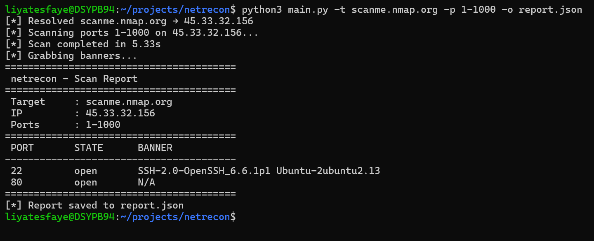

#  netrecon

A command-line network reconnaissance tool that performs TCP port scanning, banner grabbing, and structured report generation. It was built from scratch in Python using only the standard library.

##  Features

- **TCP Port Scanning** — Multi-threaded connect scanner using `ThreadPoolExecutor` for fast parallel scanning
- **DNS Resolution** — Automatically resolves domain names to IP addresses before scanning
- **Banner Grabbing** — Identifies services running on open ports by capturing their banners
- **Structured Reports** — Outputs clean terminal reports and saves results as JSON
- **Input Validation** — Validates IP addresses, port ranges, and hostnames before scanning

## Project Structure

```
netrecon/
├── main.py         # CLI entry point (argparse)
├── scanner.py      # Multi-threaded TCP port scanner
├── banner.py       # Banner grabbing
├── reporter.py     # Terminal output and JSON report generation
├── utils.py        # Input validation, DNS resolution, port parsing
└── requirements.txt
```
## Requirements

- Python 3.8+
- No external dependencies — uses only the Python standard library

## Installation

```bash
git clone https://github.com/liya_tesfaye/netrecon.git
cd netrecon
```

That's it. No `pip install` needed.

## Usage

```bash
python3 main.py --target <IP or domain> [options]
```

### Arguments

| Flag | Description | Default |
|---|---|---|
| `-t`, `--target` | Target IP address or domain name (required) | — |
| `-p`, `--ports` | Port range to scan (e.g. `1-1000`) | `1-100` |
| `-o`, `--output` | Save results to a JSON file | None |
| `--timeout` | Connection timeout per port in seconds | `1.0` |

### Examples

```bash
# Scan top 100 ports on a domain
python3 main.py -t scanme.nmap.org

# Scan ports 1-1000 and save report to JSON
python3 main.py -t scanme.nmap.org -p 1-1000 -o report.json

# Scan a specific IP with a faster timeout
python3 main.py -t 192.168.1.1 -p 1-500 --timeout 0.5

# Scan localhost
python3 main.py -t 127.0.0.1 -p 8000-9000
```
## Output



### JSON Report (`report.json`)

```json
{
    "target": "scanme.nmap.org",
    "ip": "45.33.32.156",
    "open_ports": [
        {
            "port": 22,
            "banner": "SSH-2.0-OpenSSH_6.6.1p1 Ubuntu-2ubuntu2.13"
        },
        {
            "port": 80,
            "banner": "N/A"
        }
    ]
}
```

## How It Works

1. **Input validation** — `utils.py` validates the target (IP or domain), resolves DNS, and parses the port range
2. **Port scanning** — `scanner.py` uses `ThreadPoolExecutor` to scan ports concurrently, attempting a TCP connect on each port via `socket.connect_ex()`
3. **Banner grabbing** — `banner.py` connects to each open port and reads up to 1024 bytes to identify the running service
4. **Reporting** — `reporter.py` formats results as a clean terminal table and optionally saves them as a structured JSON file

## Legal Notice

Only use this tool on systems you own or have explicit permission to scan. Unauthorized port scanning may be illegal in your jurisdiction. `scanme.nmap.org` is provided by the nmap project specifically for legal testing.

## Author

**Liya Tesfaye** — Aspiring Security Engineer
